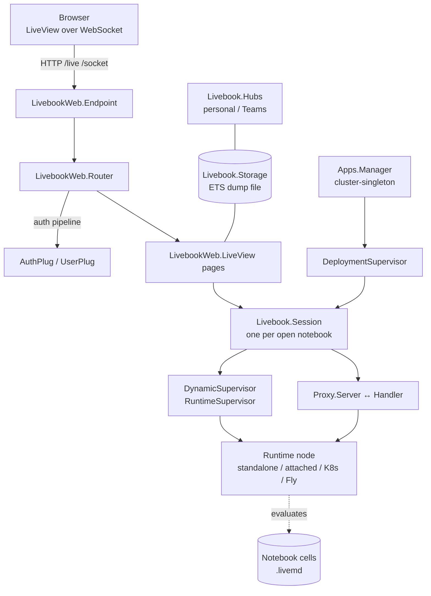

# Project Architecture

## Overview

This checkout is a fork of **Livebook**, an Elixir/Phoenix web application that
serves interactive code notebooks. A notebook is a document of Markdown and
code cells; evaluating a cell happens in a **runtime** — a separate Erlang node
that Livebook starts or attaches to — and results stream back to the browser
over a Phoenix LiveView socket. Notebooks can be read/written in the browser,
deployed as permanent **apps**, and shared/synced through **hubs** (a personal
filesystem hub or a Livebook Teams hub).

The fork (`noizu-forks/livebook`) tracks upstream `livebook-dev/livebook`; at
the checked-out SHA (version `0.20.0-dev`) there is **no in-repo source
divergence** from upstream. The architectural notes here describe that code.
The deployed instance is described under [Infrastructure](#infrastructure).

## System Diagram

## Core Components

| Component | Purpose | Where |
|-----------|---------|-------|
| `Livebook.Application` | OTP boot; builds the supervision tree | `lib/livebook/application.ex` |
| `Livebook` | Public API + `config_runtime/0` (reads `LIVEBOOK_*` env) | `lib/livebook.ex` |
| `Livebook.Storage` | ETS-backed EAV store persisted to an ETS dump file | `lib/livebook/storage.ex` |
| Runtimes | Notebook evaluators (standalone, attached, Fly, K8s, embedded) | `lib/livebook/runtime/` |
| Sessions | One process per open notebook; cell execution | `lib/livebook/session/` |
| Apps | Permanent app deployments, cluster-singleton manager | `lib/livebook/apps/` |
| Hubs | Personal/Teams hub providers + team sync client | `lib/livebook/hubs/` |
| ZTA | Zero-trust identity (`LivebookTeams`) via `nimble_zta` | `lib/livebook/zta/` |
| Web layer | Router, endpoint, LiveViews, plugs, sockets | `lib/livebook_web/` |

→ *Components ↔ directories: see [PROJ-LAYOUT.md](PROJ-LAYOUT.md)*

## Supervision Tree

`Livebook.Application.start/2` starts a `:one_for_one` supervisor containing
(ordered): optional `DNSCluster`, `Phoenix.PubSub`, `Task.Supervisor`,
migration step (`Livebook.Migration.run/0`), `Tracker`, `DynamicSupervisor`
for runtimes, `DynamicSupervisor` for sessions, a `Registry` +
`DynamicSupervisor` for hubs, a boot step that creates the Teams hub, the
`Apps.DeploymentSupervisor`, and finally the endpoint with the configured
identity provider (`LivebookWeb.ZTA`) mounted just before serving.

## Runtimes & Code Evaluation

Notebook code runs in a runtime that is a **trusted peer** of the server,
connected over Erlang distribution — code in a notebook is trusted within its
node. Livebook offers standalone (one node per notebook), attached (existing
node), Fly.io, and Kubernetes Pod runtimes; a notebook can declare its own
dependencies via `Mix.install/2`. HTTP requests destined for a runtime are
proxied through `Livebook.Proxy.Server` (Livebook side) to
`Livebook.Proxy.Handler` (runtime side) using a custom plug adapter.
Upstream runbook detail: `docs/runtime.md`.

## Web & Auth

The endpoint serves gzipped static assets, a `/live` LiveView socket, and an
app `/socket`. The router splits routes into pipelines: `:browser` (CSRF-clear
session, secure headers), `:api`, `:auth` (`UserPlug` + `AuthPlug`), and
`:user`. `/public/*` (health, session assets, audio/image inputs) is
unauthenticated by design. Authentication has three layers (upstream
`docs/authentication.md`): **instance** identity provider via
`LIVEBOOK_IDENTITY_PROVIDER` (`basic_auth`, `cloudflare`, `google_iap`,
`tailscale`, `custom:Module`, or Livebook Teams), **admin** token/password
(`LIVEBOOK_TOKEN_ENABLED`, `LIVEBOOK_PASSWORD`), and per-app notebook
passwords. `AuthPlug` compares a hashed secret from the signed session cookie
(`lb_session`); `authorized?/1` additionally requires `access_type == :full`
(apps-only users cannot reach admin pages).

## Persistence

There is **no relational database**. Durable state lives on the filesystem
under `LIVEBOOK_HOME` / `LIVEBOOK_DATA_PATH` (notebooks, app data, hub
configs, secrets) with `Livebook.Storage` providing an ETS read cache synced
to a JSON file. See [PROJ-SCHEMA.md](PROJ-SCHEMA.md).

## Technology Stack

Elixir 1.20.1 / Erlang OTP 28.1.1 (pinned in `versions`), Phoenix 1.8,
Phoenix LiveView 1.1, Bandit HTTP server, `nimble_zta` for zero-trust identity,
`protobuf` for Teams sync, `kubereq` for the K8s runtime, `yaml_elixir`,
`mint_web_socket`, `req`; frontend via bun + vite; desktop shell via Tauri.

## Infrastructure

In the Noizu monorepo, Livebook is deployed by Terraform
(`terraform/kubernetes/platform/ai/livebook.tf`) as a single-replica
`Recreate` Deployment in the platform-AI namespace, served at **nb.noizu.com**.

- **Image**: `ghcr.io/livebook-dev/livebook:0.19.10` — the **upstream published
  image**, not an image built from this fork. The running instance is therefore
  a release behind this 0.20.0-dev tree.
- **State**: `ReadWriteOnce` PVC `livebook-data` (10Gi, dynamic provisioning);
  init container seeds `/data/{home,notebooks,app-data,.mix-installs}`;
  container runs as root. Env: `LIVEBOOK_IP=0.0.0.0`, `LIVEBOOK_PORT=8080`,
  `HOME=/data/home`, `LIVEBOOK_HOME=/data/notebooks`,
  `LIVEBOOK_DATA_PATH=/data/app-data`, `MIX_INSTALL_DIR=/data/.mix-installs`.
- **Secrets**: Infisical `InfisicalSecret` from path `/ai/livebook` →
  `livebook-app-secrets` (`includeAllSecrets`), supplying password / secret
  key base and any other `LIVEBOOK_*` values.
- **Entrypoint wrapper**: the image ships only gzipped static assets, but the
  cluster's ingress-nginx forces `Accept-Encoding: identity` upstream, so the
  container `gunzip`s assets in place at startup before `exec /app/bin/server`.
- **Ingress**: TLS `cloudflare-tls-synced`, client-cert verification
  (`auth-tls-verify-client: on`) against the Cloudflare origin cert,
  `proxy-body-size 50m`, 3600s read/send timeouts, HTTP/1.1 (WebSocket).
- **Probes**: liveness/readiness GET `/public/health` on port 8080.

See [THREAT-MODEL.md](THREAT-MODEL.md) for the security view of this
deployment.

## Key Decisions

- **Runtime-per-notebook isolation** rather than in-process eval: notebook
  code is arbitrary and dependency-heavy; a dedicated node isolates it and
  allows `Mix.install/2`.
- **Filesystem EAV storage** instead of a database: keeps Livebook
  single-binary deployable, at the cost of single-writer/single-user
  assumptions (relevant to the deployment above).
- **Fork as mirror**: this repo exists to track upstream; the deployment
  consumes the upstream image, so divergences here do not reach production
  unless re-pointed.
