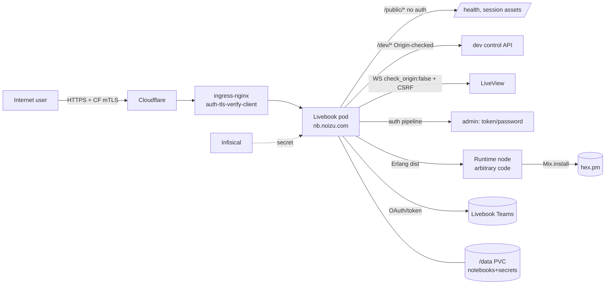

# Threat Model

## Overview

Livebook is an interactive notebook server: it accepts code from users and
**executes it**. That is the product, not a defect — but it means the crown
jewels are (1) the ability to run arbitrary code in a runtime, (2) the secrets
and environment variables attached to notebooks/apps, (3) the admin interface,
and (4) the persisted notebook/data volume.

This model describes the `noizu-forks/livebook` code **as deployed** in the
Noizu cluster: a single-replica pod at `nb.noizu.com` running the upstream
image, fronted by Cloudflare and ingress-nginx, state on a 10Gi PVC. It is
derived from `lib/livebook_web/{router,endpoint,plugs}`, `lib/livebook/zta/`,
`lib/livebook/storage.ex`, the upstream `docs/authentication.md` /
`docs/dev_endpoints.md`, and `terraform/kubernetes/platform/ai/livebook.tf`.

## Trust Boundaries

1. **Internet → edge**: Cloudflare terminates TLS; the cluster ingress
   additionally requires a client certificate (`auth-tls-verify-client: on`
   against `cloudflare-tls-synced`).
2. **Edge → pod**: ingress-nginx → Livebook HTTP on 8080 (prefix `/`).
3. **Browser → server**: HTTP + LiveView WebSocket (`/live`, `/socket`),
   `check_origin: false`, CSRF token guarding.
4. **Server → runtime**: Erlang distribution to a separate VM per notebook.
   Runtimes are **trusted peers** — notebook code is trusted within its node.
5. **Server → third parties**: Livebook Teams (`teams.livebook.dev`) OAuth/sync,
   `hex.pm` for `Mix.install/2`, optional AWS credential chain.
6. **Infisical → pod**: `InfisicalSecret` syncs `/ai/livebook` into
   `livebook-app-secrets`.
7. **Unauthenticated `/public/*`**: health and session asset inputs.
8. **`/dev/*`**: local control API, disabled by default.

## Attack Surface

## Vulnerability Register

| ID | Severity | STRIDE | Component | Status |
|----|----------|--------|-----------|--------|
| T-001 | High | Elevation | Notebook code executes arbitrary code in runtimes | By design; isolated to a per-notebook node, not a security sandbox |
| T-002 | High | Elevation | `/dev/*` control API has no auth beyond `Origin`-header rejection | Mitigated-by-default: disabled; deployment does not enable it; only reachable if exposed |
| T-003 | Medium | Tampering/Spoofing | WebSocket `check_origin: false` (CSWSH) | Partial: CSRF token; session cookie signed |
| T-004 | High | Spoofing | Admin auth token/password; token printed to logs if unset | Mitigated: password/secret supplied via Infisical `/ai/livebook` |
| T-005 | Medium | Elevation | Container runs as root (`run_as_user: 0`), writable `/data` | Accepted deployment choice |
| T-006 | Medium | Spoofing | Cloudflare origin client-cert is the network gate | Mitigated: `cloudflare-tls-synced` + TLS verify |
| T-007 | Medium | Info disclosure | Hub secrets encrypted at rest but key stored in same store | Partial |
| T-008 | Medium | Tampering (supply chain) | Runs upstream `ghcr.io/livebook-dev/livebook:0.19.10` (tag, not digest) | Partial: pinned tag; upstream trust; not built from this fork |
| T-009 | Medium | Spoofing | Livebook Teams identity-callback CSRF | Mitigated: `teams_state` `secure_compare` in `validate_auth_state?` |
| T-010 | Medium | Tampering | Notebook file import path traversal / env-var injection in app shell instructions | Mitigated: entry-name validation + env-var escaping (recent commits) |
| T-011 | Medium | Spoofing | Erlang distribution cookie joining runtimes | Mitigated: `LIVEBOOK_COOKIE` random by default |
| T-012 | Low | DoS | Large uploads / long-lived WS | Partial: ingress `proxy-body-size 50m`, 3600s timeouts |

## Mitigation Coverage

Reviewer note: statuses are derived from source paths, not from runtime testing.

- **Mitigated / mitigated-by-default**: T-004, T-006, T-009, T-010, T-011, T-002.
- **Partial**: T-003, T-007, T-008, T-012.
- **By design**: T-001. **Accepted**: T-005.

## Residual Risk

- **Arbitrary code execution is the feature.** Runtime isolation separates
  notebooks from each other and from the server process, but it is not a
  hardened sandbox — do not treat runtime nodes as untrusted-code containers.
- **Root + writable PVC** is accepted for single-writer operation; the storage
  model assumes one operator, not multi-tenant isolation.
- **Upstream image supply chain** is trusted implicitly: the deployment pulls
  the published image by tag. Building from this fork or pinning a digest
  would tighten T-008.
- **`/dev/*`** must stay disabled on any network-exposed instance (upstream
  warns explicitly); enabling it while reachable bypasses auth entirely.
